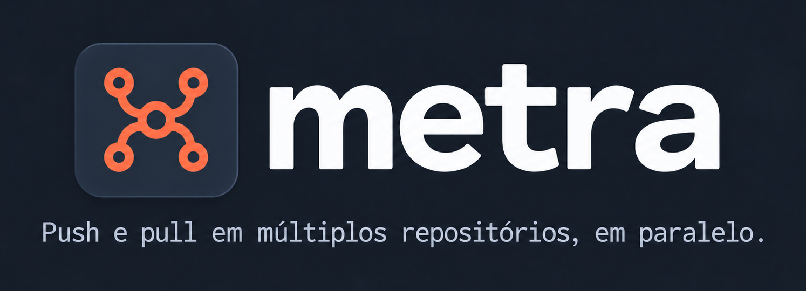
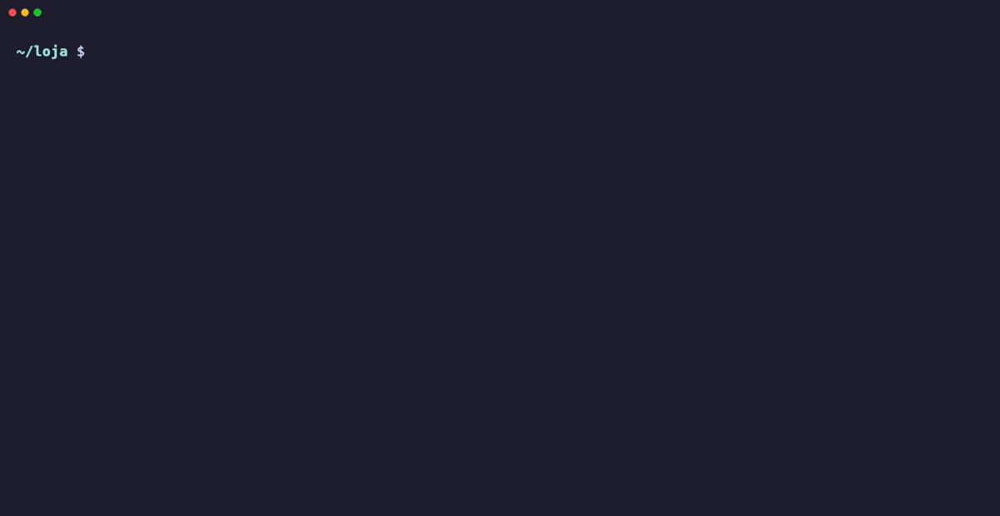
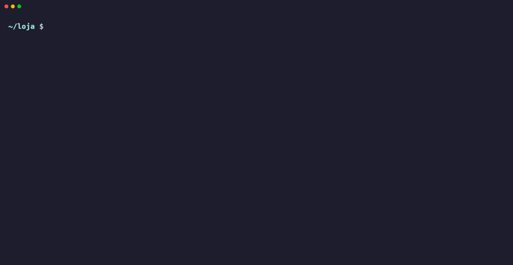
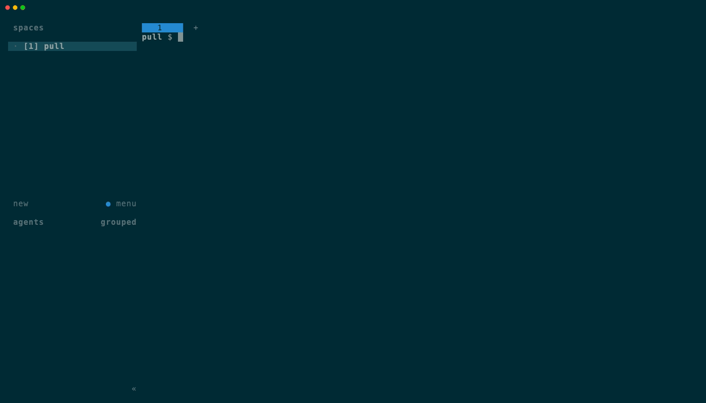

<div align="center">



**`git pull` e `git push` em paralelo em todos os repositórios do seu workspace multi-repo.**

Uma TUI acompanha o progresso, agrupa as falhas por tipo e mostra o log de cada repositório com a próxima ação sugerida.

[](Cargo.toml)
[](https://ratatui.rs)
[](Cargo.toml)



</div>

## Instalação

Requer Rust 1.88+ e Git 2.34+.

```sh
git clone https://github.com/MarcusToledo/metra.git
cd metra
cargo install --path .
```

## Início rápido

Na raiz do workspace (ou em qualquer subpasta dele, se houver um `.meta`):

```sh
metra pull        # traz as mudanças do remote upstream
metra push        # envia as branches atuais para origin
```

O metra encontra os repositórios sozinho: usa o `.meta` mais próximo ou, sem ele, as subpastas do diretório atual que têm `.git`. Veja [Descoberta dos repositórios](docs/referencia.md#descoberta-dos-repositórios).

<div align="center">

</div>

## Uso

```text
metra pull [-j N] [--remote NOME] [--fonte auto|meta|varredura]
metra push [-j N] [--remote NOME] [--fonte auto|meta|varredura]
```

| Opção | Padrão | Descrição |
|---|---|---|
| `-j N`, `--jobs N` | `8` | Número de tarefas paralelas. |
| `--remote NOME` | `upstream` no pull; `origin` no push | Remote usado na operação. |
| `--fonte` | `auto` | `.meta` se existir, senão varredura das subpastas; force com `meta` ou `varredura`. |

O código de saída é `0` sem falhas, `1` com falhas e `2` para erro de argumentos ou descoberta. Cada execução grava um log em `$XDG_STATE_HOME/metra/` (padrão `~/.local/state/metra/`).

### Atalhos

| Tecla | Ação |
|---|---|
| `↑` / `k`, `↓` / `j` | Move a seleção |
| `Enter` | Abre ou fecha o detalhe com o log |
| `PgUp` / `PgDn` | Rola o log |
| `r` | Repete o repositório selecionado |
| `n` | Repete com `--no-rebase` (só no pull) |
| `R` | Repete todas as falhas |
| `p` | Abre um pane do herdr no repositório |
| `m` | Abre o link de merge/pull request |
| `Esc` | Fecha o detalhe; sem detalhe aberto, sai |
| `q` | Sai aguardando as tarefas; pressionado de novo, aborta |

Dentro do [herdr](https://herdr.dev), `p` abre um pane abaixo do metra já na pasta do repositório selecionado, para resolver a falha sem sair da tela:

<div align="center">

</div>

Descoberta, tipos de falha, atalhos, saída, execução segura e logs estão detalhados na [referência](docs/referencia.md).

## Desenvolvimento

```sh
cargo test
cargo clippy --all-targets -- -D warnings
```

Os testes de integração de pull exigem que o Git não tenha `pull.rebase` nem `pull.ff` na configuração global. As demos deste README são gravadas com [VHS](https://github.com/charmbracelet/vhs) a partir de [`docs/demo/`](docs/demo/). Requisitos, arquitetura e contratos de cada feature estão em [`specs/`](specs/); o mapa do código está em [`docs/CONTEXTO.md`](docs/CONTEXTO.md) e as instruções para agentes de IA em [`AGENTS.md`](AGENTS.md).
