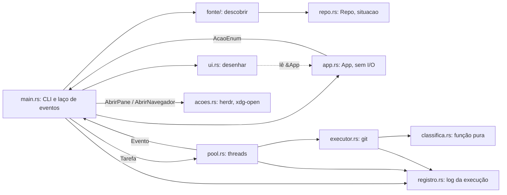

# Contexto do metra

Mapa para quem (pessoa ou agente) vai mexer no código. Regras: [constituição](../.specify/memory/constitution.md). Uso: [README](../README.md) e [referência](referencia.md). Detalhe de cada feature: `specs/NNN-nome/`.

## Problema

Workspaces multi-repo (com `.meta` da ferramenta `meta` ou só pastas com repositórios) precisam de `git pull`/`git push` em todos os repositórios. O metra roda tudo em paralelo, mostra o progresso numa TUI, agrupa as falhas no topo com motivo classificado e dica, e oferece ações para resolver sem sair da tela: repetir, repetir com `--no-rebase`, abrir pane do herdr no repositório, abrir o link de merge anunciado pelo push.

## Arquitetura

`registro.rs` é módulo folha: não importa nenhum outro módulo do crate. `lib.rs` expõe todos os módulos para os testes de integração em `tests/`.

## Módulos

| Arquivo | Responsabilidade | Símbolos principais |
|---|---|---|
| `src/main.rs` | clap, inicia o registro, descobre os repos, laço da TUI, resumo final e código de saída | `main`, `ComandoEnum`, `Opcoes` |
| `src/repo.rs` | Tipo neutro entre fonte e executor | `Repo`, `SituacaoRepoEnum`, `situacao` |
| `src/fonte/` | Descoberta por `.meta` (ordem do arquivo) ou varredura de subpastas | `FonteEnum`, `FonteRepos`, `resolver_fonte`, `descobrir` |
| `src/executor.rs` | Pull/push síncrono num repositório, cancelamento, link de merge | `Tarefa`, `OperacaoEnum`, `Resultado`, `EstadoRepoEnum`, `Cancelamento`, `executar`, `versao_git` |
| `src/classifica.rs` | Classifica stdout+stderr do git | `TipoErroEnum`, `classificar` |
| `src/pool.rs` | Pool fixo de threads; emite eventos para a TUI | `Pool`, `Evento` |
| `src/app.rs` | Estado da tela, grupos de linhas, tecla → ações, resumo | `App`, `LinhaEnum`, `AcaoEnum` |
| `src/ui.rs` | Renderiza `&App` com ratatui | `desenhar` |
| `src/acoes.rs` | Integrações opcionais | `abrir_pane_herdr`, `abrir_navegador` |
| `src/registro.rs` | Um log por execução em `$XDG_STATE_HOME/metra/`, retenção de 20, mascara credenciais | `iniciar`, `registrar`, `NivelEnum`, `instalar_hook_panic` |

Testes de integração: `tests/executor.rs`, `tests/fonte.rs`, `tests/pool.rs`, `tests/registro.rs`.

## Fluxo de uma execução

1. `main` lê `metra pull|push [-j N] [--remote NOME] [--fonte auto|meta|varredura]`; remote padrão `upstream` no pull e `origin` no push.
2. Inicia o registro e instala o hook de panic (antes do `ratatui::init`).
3. `fonte::descobrir` devolve a raiz e os `Repo`; erro vai para o stderr com saída 2, sem abrir a TUI.
4. A TUI abre; o pool de N threads recebe uma `Tarefa` por repositório clonado.
5. Cada worker chama `executor::executar`; falha vira `EstadoRepoEnum::Falhou(TipoErroEnum)` via `classifica::classificar`; o resultado volta como `Evento::Terminou`.
6. O laço aplica eventos no `App`, lê teclas (`App::tratar_tecla` → `AcaoEnum`) e redesenha.
7. `q` encerra esperando as tarefas em execução; `q` de novo aborta, matando o grupo de processos de cada git (e do ssh filho).
8. O terminal é restaurado sempre; o stdout recebe o resumo e as linhas `merge <repo>: <url>`; o código de saída é 0 (sem falhas), 1 (falhas) ou 2 (configuração/descoberta).

## Glossário

- **Raiz**: diretório do `.meta` mais próximo, ou o diretório atual na varredura.
- **Fonte**: de onde vem a lista de repositórios (`auto`, `meta`, `varredura`).
- **Situação**: `Clonado`, `NaoClonado` (caminho ausente) ou `SemRepositorio` (pasta sem `.git` próprio); só `Clonado` executa git.
- **Estado**: `Pendente`, `Executando`, `SemMudanca`, `Recebido(n)`, `Enviado`, `Falhou(tipo)`.
- **Link de merge**: URL de merge/pull request que o remote anuncia no push; tecla `m` abre.
- **Pane do herdr**: painel do multiplexador herdr aberto no repositório (tecla `p`, requer `HERDR_ENV=1`).

## Decisões registradas

- `specs/001-metra-pull-push/research.md`: R1 ratatui 0.30 com crossterm reexportado; R2 mensagens reais do git 2.34.1; R3 ordem das chaves do `.meta` com `Deserialize` manual; R4 pool de threads e cancelamento; R5 contagem de commits com `rev-parse`/`rev-list`; R6 herdr.
- `specs/002-registro-logs/research.md`: R1 local dos arquivos; R2 um arquivo por execução, retenção de 20; R3 UTC sem dependência; R4 escrita sem buffer; R5 registro global; R6 panic com backtrace e ordem dos hooks; R7 mascaramento de credenciais; R8 pontos de registro.

## Features

| Spec | Status | Resumo |
|---|---|---|
| [001-metra-pull-push](../specs/001-metra-pull-push/) | Concluída | Pull/push paralelo, TUI de triagem, ações, link de merge, aborto |
| [002-registro-logs](../specs/002-registro-logs/) | Concluída | Log persistente por execução |

## Armadilhas conhecidas

- `pull.rebase` ou `pull.ff` no git global quebram os testes de integração de pull.
- A classificação depende do texto do git 2.34 em `LC_ALL=C`; outra versão ou locale pode cair em `Desconhecido`.
- O registro global (`OnceLock`) não faz nada se não foi iniciado: testes e uso como biblioteca não gravam log.
- Git sobe a árvore procurando repositório; por isso nunca rode git em pasta sem `.git` próprio.
- `.specify/feature.json` não vem no clone; recrie em cada máquina (ver `AGENTS.md`).
