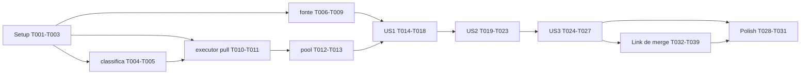

---

description: "Task list for metra pull/push"
---

# Tasks: metra pull/push com TUI de progresso e triagem de falhas

**Input**: Design documents from `specs/001-metra-pull-push/`

**Prerequisites**: plan.md, spec.md, research.md, data-model.md, contracts/cli.md, contracts/tui.md

**Tests**: obrigatórios pela constituição (princípio III). Em cada bloco, a tarefa de teste vem
antes da implementação correspondente.

**Gate por fase** (constituição III): antes de cada commit, `cargo test` e
`cargo clippy --all-targets -- -D warnings` limpos e `cargo fmt` aplicado.

**Organization**: fundação compartilhada (tipos, classificação, descoberta completa, executor de
pull, pool) seguida de uma fase por história. A US4 (varredura) é entregue na fundação porque o
`main` da US1 já depende de `descobrir` com todos os modos.

## Format: `[ID] [P?] [Story] Description`

- **[P]**: pode rodar em paralelo (arquivo diferente de qualquer outra tarefa pendente da fase)
- **[Story]**: US1–US3 conforme spec.md

## Path Conventions

Projeto único: `src/`, `tests/` na raiz do repositório.

---

## Phase 1: Setup

- [X] T001 Adicionar dependências em Cargo.toml: `cargo add ratatui anyhow serde_json`, `cargo add clap --features derive`, `cargo add serde --features derive`, `cargo add --dev tempfile`
- [X] T002 Criar src/lib.rs com `pub mod repo; pub mod fonte; pub mod classifica; pub mod executor; pub mod pool; pub mod app; pub mod acoes; pub mod ui;` e os arquivos src/repo.rs, src/fonte/mod.rs (`mod meta; mod varredura;`), src/fonte/meta.rs, src/fonte/varredura.rs, src/classifica.rs, src/executor.rs, src/pool.rs, src/app.rs, src/acoes.rs, src/ui.rs; src/main.rs mínimo que compila
- [X] T003 Definir os tipos públicos compartilhados (só tipos, sem lógica) conforme plan.md/data-model.md: `Repo`, `SituacaoRepoEnum` em src/repo.rs; `FonteEnum` (derive `clap::ValueEnum`) e trait `FonteRepos` em src/fonte/mod.rs; `TipoErroEnum` em src/classifica.rs; `OperacaoEnum`, `Tarefa { indice, repo, operacao, remote, sem_rebase }`, `EstadoRepoEnum`, `Resultado { estado, branch, log }` em src/executor.rs; `Evento { Iniciou(usize), Terminou(usize, Resultado), PoolEncerrado }` em src/pool.rs; `LinhaEnum { Repo(usize), SemMudanca(Vec<usize>), NaoClonados(Vec<usize>), SemRepositorio(Vec<usize>) }`, `AcaoEnum { Enviar(Tarefa), AbrirPane(PathBuf), Sair }` e `struct App` com os campos de data-model.md em src/app.rs

**Checkpoint**: `cargo build` compila; commit `chore: estrutura de modulos e tipos compartilhados`.

---

## Phase 2: Foundational (Blocking Prerequisites)

**⚠️ CRITICAL**: nenhuma história começa antes desta fase. Blocos classifica, fonte e executor
podem avançar em paralelo (arquivos disjuntos); executor depende de `classificar` (T005) para os
testes passarem.

### Classificação

- [X] T004 [P] Testes unitários em `#[cfg(test)] mod tests` de src/classifica.rs para cada regra da FR-013 com os textos reais de research.md R2: divergente; conflito com `["a.txt"]` extraído; merge pendente ("Pulling is not possible…" e "You have not concluded your merge"); alterações locais; não rastreados; branch remota inexistente; remote inexistente (texto real contém também "Could not read from remote repository" → deve dar RemoteInexistente); push rejeitado; rede "Could not resolve host"; "Host key verification failed"; "terminal prompts disabled"; Desconhecido com a última linha não vazia; `texto()` de Conflito com 5 arquivos = "conflito em a, b, c (+2)"; `dica()` dos três grupos (FR-014)
- [X] T005 Implementar `pub fn classificar(texto: &str) -> TipoErroEnum`, `texto(&self) -> String` e `dica(&self) -> &'static str` em src/classifica.rs com a tabela da FR-014

### Descoberta (meta, varredura, auto)

- [X] T006 [P] Testes em tests/fonte.rs: `situacao` para `.git` diretório, `.git` arquivo, caminho ausente e pasta sem `.git`; `.meta` com chaves fora de ordem alfabética (`zeta`, `alfa`) preserva a ordem do arquivo; chave `grupo/repo` vira `raiz/grupo/repo`; JSON inválido → erro; `.meta` sem `projects` → erro; `descobrir(Meta)` sem `.meta` → erro contendo "nenhum .meta encontrado a partir de <cwd>"; `descobrir(Auto)` num subdiretório com `.meta` no ancestral → raiz = ancestral; varredura lista só subpastas não ocultas com `.git`, por nome, ignorando `.oculta`, pasta sem `.git` e a raiz; `descobrir(Auto)` sem `.meta` → varredura com raiz = cwd; `descobrir(Varredura)` ignora `.meta` existente; `.meta` com `projects` vazio e diretório sem repos → erro "nenhum repositório encontrado em <raiz>"
- [X] T007 Implementar `situacao` em src/repo.rs e `resolver_fonte` + `descobrir` em src/fonte/mod.rs (procura `.meta` no cwd e ancestrais)
- [X] T008 Implementar `FonteMeta` em src/fonte/meta.rs com `Deserialize` manual (`visit_map`) preservando a ordem das chaves de `projects` (research.md R3); erros com a mensagem do parser e o caminho do arquivo
- [X] T009 Implementar `FonteVarredura` em src/fonte/varredura.rs

### Executor de pull

- [X] T010 [P] Testes em tests/executor.rs. Helper que (a) falha com mensagem clara se `git config --get pull.rebase` ou `pull.ff` estiverem definidos fora do repo de teste (research.md R2), (b) cria em `tempfile::TempDir` um bare "upstream", um clone de trabalho com remote `upstream`, `user.name`/`user.email` locais, e um clone auxiliar para avançar o upstream. Cenários de pull: sem mudança → `SemMudanca`; upstream +2 commits → `Recebido(2)`; divergente → `Falhou(Divergente)`; divergente com `sem_rebase` → `Recebido(2)`; conflito → `Falhou(Conflito(["a.txt"]))`; alterações locais → `Falhou(AlteracoesLocais)`; branch remota inexistente → `Falhou(BranchRemotaInexistente)`; remote `nao-existe` → `Falhou(RemoteInexistente)`; HEAD destacado → `Falhou(HeadDestacado)` com HEAD inalterado; `Resultado.branch` = branch atual; `Resultado.log` contém a saída do `git pull`; `Repo` `SemRepositorio` (pasta sem `.git` dentro de um repo pai) → `Falhou`, sem alterar `rev-parse HEAD` do pai
- [X] T011 Implementar em src/executor.rs o helper privado `git(caminho, args) -> (bool, String)` (`Command::new("git").arg("-C")`, envs `GIT_TERMINAL_PROMPT=0` e `LC_ALL=C`, `GIT_SSH_COMMAND=ssh -o BatchMode=yes` quando `GIT_SSH_COMMAND`/`GIT_SSH` ausentes e `core.sshCommand` vazio, `stdin(Stdio::null())`, log com `$ git <args>` seguido de stdout+stderr) e `pub fn executar(tarefa: &Tarefa) -> Resultado` para Pull (FR-009; falha de `rev-parse` → `Falhou(Desconhecido(<última linha>))`; não `Clonado` → `Falhou(Desconhecido("repositório não clonado"))` sem processo)

### Pool

- [X] T012 Testes em tests/pool.rs: 4 tarefas reais com `n = 2` → 4 `Iniciou` + 4 `Terminou`, máximo de `Iniciou − Terminou` simultâneos ≤ 2, e `PoolEncerrado` após `encerrar`; com `n = 1` e 3 tarefas, chamar `encerrar` ao receber o primeiro `Iniciou` → menos de 3 `Terminou` antes de `PoolEncerrado` (fila descartada sem evento)
- [X] T013 Implementar em src/pool.rs `Pool::iniciar(n, eventos: mpsc::Sender<Evento>) -> Pool`, `enviar(&self, Tarefa)` e `encerrar(&mut self)` conforme plan.md (workers em `Arc<Mutex<Receiver<Tarefa>>>`, `Arc<AtomicBool>` `cancelado`, thread vigia emitindo `PoolEncerrado`)

**Checkpoint**: gate verde; commit `feat: classificacao, descoberta, executor de pull e pool`.

---

## Phase 3: User Story 1 - Atualizar o workspace e ver só o que falhou (P1) 🎯 MVP

**Goal**: `metra pull` executa em paralelo e mostra falhas agrupadas no topo, com linha-resumo e
exit code.

**Independent Test**: quickstart.md seção 2 — TUI mostra os grupos esperados; `q` imprime a
linha-resumo e devolve 1; repo pai inalterado.

- [X] T014 [US1] Testes em `#[cfg(test)] mod tests` de src/app.rs: `tarefas_iniciais()` só com Clonado, na ordem da fonte; `linhas()` na ordem de grupos da FR-016 e da fonte dentro do grupo, agregadas omitidas quando vazias; `aplicar(Iniciou/Terminou)` atualiza estado, branch e log; navegação ↑/↓/k/j limitada; Enter alterna detalhe; PgUp/PgDn alteram `rolagem` só com detalhe aberto; Esc fecha detalhe, senão `Sair`; `q` → `Sair`, `saindo = true`, status "aguardando N tarefas…" com N = Executando; `PoolEncerrado` → `encerrado`; `resumo()` de pull com e sem falhas no formato de contracts/cli.md, pendentes fora de qualquer grupo; `codigo_saida()` 0/1
- [X] T015 [US1] Implementar em src/app.rs: `App::new(operacao, remote, raiz, repos)`, `tarefas_iniciais`, `linhas`, `aplicar`, `executando() -> usize`, `concluidos() -> (usize, usize)`, `tratar_tecla(KeyCode) -> Vec<AcaoEnum>` (navegação, Enter, PgUp/PgDn, q, Esc), `resumo`, `codigo_saida`
- [X] T016 [P] [US1] Testes em `#[cfg(test)] mod tests` de src/ui.rs com `ratatui::backend::TestBackend` 80×24: 45 repos com 10 falhas → as 10 linhas `✗` visíveis; cabeçalho `metra pull · remote upstream · <raiz>` com `concluídos/total`; rodapé de contracts/tui.md; detalhe aberto mostra branch, dica e log
- [X] T017 [US1] Implementar `pub fn desenhar(frame: &mut Frame, app: &App)` em src/ui.rs conforme contracts/tui.md (spinner, símbolos, painel de detalhe com `Paragraph::scroll`, barra de status, rodapé)
- [X] T018 [US1] Implementar src/main.rs: clap (`pull`/`push`, `-j/--jobs` ≥ 1 padrão 8, `--remote`, `--fonte`), `descobrir` (erro → stderr, exit 2), `Pool::iniciar` + `tarefas_iniciais`, `ratatui::init()`, `rodar(...) -> anyhow::Result<()>` (drena `try_recv`, `event::poll(100ms)` filtrando `KeyEventKind::Press`, `desenhar`; `Sair` → `pool.encerrar()` e segue até `PoolEncerrado`), `ratatui::restore()` incondicional antes de tratar o erro (FR-026), imprime `resumo()`, `process::exit(codigo_saida())`

**Checkpoint**: gate verde; commit `feat: tui de pull com grupos e linha-resumo`.

---

## Phase 4: User Story 2 - Investigar e resolver falhas sem sair da TUI (P2)

**Goal**: ações `r`, `n`, `R`, `p` e detalhe com dica.

**Independent Test**: na fixture, `n` em `diverge` → `↓ diverge  2 commits`; `p` em `conflita`
dentro do herdr abre pane no repo.

- [X] T019 [US2] Testes em src/app.rs: `r` em Falhou → `Pendente`, log descartado e `Enviar` com `sem_rebase = false`; `n` no pull → `sem_rebase = true`; `n` no push → status "indisponível no push" sem ação; `R` reenvia todas as falhas; `r`/`n` em agregada, não Clonado, Pendente ou Executando → status e nenhuma ação; `p` em Clonado → `AbrirPane(caminho)`; `p` em agregada/não Clonado → status; após `q`, `r`/`n`/`R`/`p` ignorados
- [X] T020 [US2] Implementar `r`, `n`, `R`, `p` em `App::tratar_tecla` em src/app.rs
- [X] T021 [P] [US2] Testes em `#[cfg(test)] mod tests` de src/acoes.rs: `abrir_pane_com(None, …)` e `abrir_pane_com(Some("0"), …)` → `Err("herdr indisponível")` (sem executar herdr)
- [X] T022 [US2] Implementar em src/acoes.rs `abrir_pane_com(herdr_env: Option<&str>, caminho) -> Result<(), String>` (`herdr pane split --current --direction down --cwd <caminho absoluto>`; spawn falhou → "herdr indisponível"; exit ≠ 0 → stderr aparado) e `pub fn abrir_pane_herdr(caminho)` lendo `HERDR_ENV`
- [X] T023 [US2] Em src/main.rs, tratar `AcaoEnum::Enviar` (`pool.enviar`) e `AcaoEnum::AbrirPane` (`abrir_pane_herdr`; erro → `app.status`)

**Checkpoint**: gate verde; commit `feat: acoes de reexecucao e pane do herdr`.

---

## Phase 5: User Story 3 - Publicar com `metra push` (P3)

**Goal**: push com os mesmos grupos e ações (exceto `n`).

**Independent Test**: cenários de push em tests/executor.rs e `resumo()` de push.

- [X] T024 [P] [US3] Testes em tests/executor.rs: push com commit local → `Enviado`; push sincronizado → `SemMudanca`; remote avançado → `Falhou(PushRejeitado)`
- [X] T025 [US3] Implementar Push em `executar` em src/executor.rs (FR-010)
- [X] T026 [P] [US3] Testes em src/app.rs: `resumo()` de push usa `enviados`; linhas `↑` agrupadas com Recebido/Enviado
- [X] T027 [US3] Ajustar src/app.rs para push (se T026 falhar) e garantir remote padrão `origin` no push em src/main.rs

**Checkpoint**: gate verde; commit `feat: metra push`.

---

## Phase 7: Emenda — Link de merge no push (FR-028, FR-029)

**Goal**: detectar link de merge no push, `m` abre no navegador, links impressos após a saída.

**Independent Test**: hook post-receive anunciando link → `↑ trab  ⇗ merge`, detalhe `merge: <url>`.

- [X] T032 [P] [US3] Testes em `#[cfg(test)] mod tests` de src/executor.rs: `extrair_link_merge` com GitLab criação, GitLab existente, GitHub, URL sem anúncio → None, push sem `remote:` → None
- [X] T033 [P] [US3] Teste em tests/executor.rs: hook post-receive com anúncio GitLab → `Enviado` e `link_merge` = URL; `link_merge == None` em push sem hook e sem mudança
- [X] T034 [US3] Implementar `Resultado::link_merge` e `extrair_link_merge` em src/executor.rs (FR-028)
- [X] T035 [P] [US3] Testes em src/app.rs: `m` com link → `AbrirNavegador(url)`; sem link/agregada → status; após `q` → ignorado; detalhe `merge: <url>`; `r` descarta link; `linhas_merge()`
- [X] T036 [US3] Implementar `links_merge`, `AcaoEnum::AbrirNavegador`, tecla `m`, detalhe e `linhas_merge()` em src/app.rs (FR-016, FR-017, FR-029)
- [X] T037 [P] [US3] Teste em src/ui.rs: `↑ <repo>  ⇗ merge` e `merge: https://` no detalhe; implementar marca e rodapé
- [X] T038 [US3] Implementar `abrir_navegador` em src/acoes.rs e tratar `AbrirNavegador` + impressão de `linhas_merge()` em src/main.rs (FR-023, FR-029)
- [X] T039 Atualizar README.md (atalho `m`, marca `⇗ merge`, linhas `merge` no stdout); `cargo fmt`, `cargo clippy --all-targets -- -D warnings`, `cargo test`; smoke de push com link

**Checkpoint**: gate verde; commit `feat: link de merge no metra push`.

---

## Phase 6: Polish & Cross-Cutting

- [X] T028 `cargo fmt`, `cargo clippy --all-targets -- -D warnings` e `cargo test` limpos
- [X] T029 [P] Escrever README.md (pt-BR): propósito, instalação (`cargo install --path .`), uso (contracts/cli.md), atalhos (contracts/tui.md), pré-requisito dos testes (sem `pull.rebase`/`pull.ff` globais)
- [X] T030 [P] Script descartável /tmp/metra-fixture.sh (fora do repositório) conforme quickstart.md seção 2
- [X] T031 Executar quickstart.md seções 1–3 e registrar o resultado

---

## Dependencies & Execution Order



Ordem de dependência: setup → classifica → fonte → executor → pool → app/ui/acoes → main →
quickstart.

## Parallel Example

```text
Fase 2 (após T003): classifica (src/classifica.rs) | fonte (src/repo.rs, src/fonte/*, tests/fonte.rs)
                    | executor (src/executor.rs, tests/executor.rs); depois pool (src/pool.rs, tests/pool.rs)
Fase 3: app (src/app.rs: T014→T015) | ui (src/ui.rs: T016→T017); depois main (T018)
Fase 4: app (T019→T020) | acoes (T021→T022); depois main (T023)
Fase 5: executor (T024→T025) | app (T026→T027)
```

## Implementation Strategy

- MVP = Setup + Foundational + US1 (pull com grupos e linha-resumo).
- Incremento 2: US2 (ações) — valor principal sobre o `mgpull`.
- Incremento 3: US3 (push).
